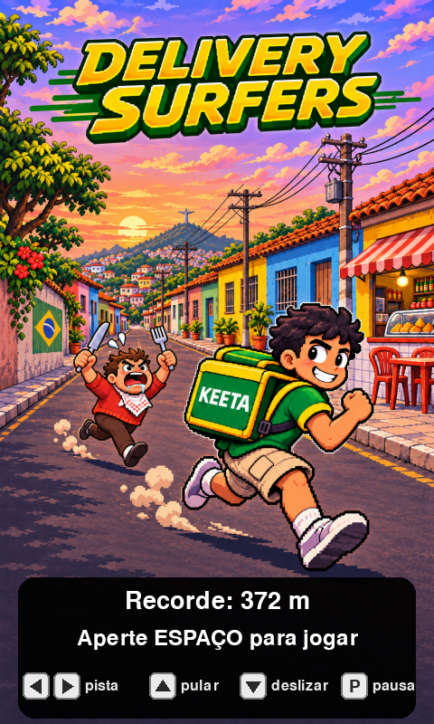
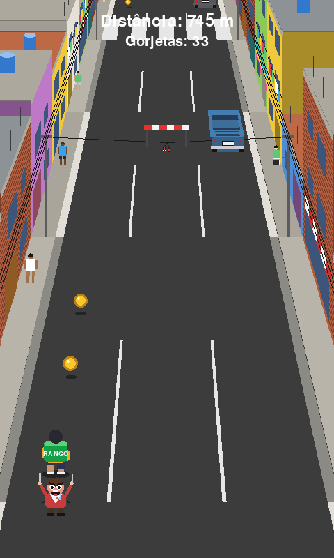
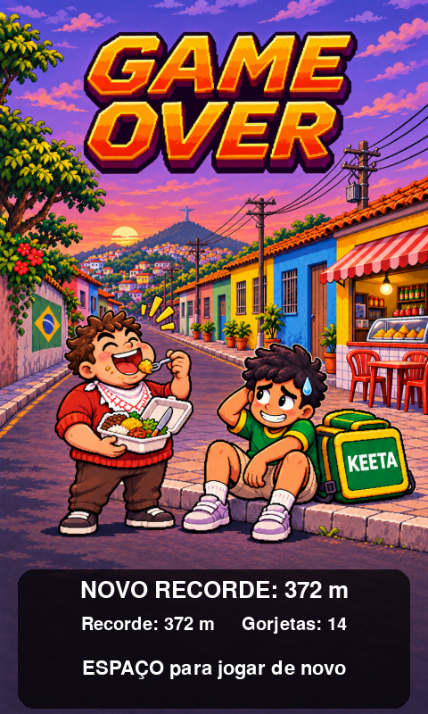

# Jogo-Dsoft-
# Delivery Surfers

Jogo de corrida infinita feito em PyGame para o projeto final de Design de Software (Insper, 2026).
Um entregador de aplicativo corre por uma rua de comunidade brasileira, fugindo de um **cliente com fome**
que vem logo atrás. Desvie dos obstáculos, pegue gorjetas e corra o mais longe que conseguir.

> Inspirado em *Subway Surfers*. Sem vínculo com o jogo original nem com qualquer aplicativo de entregas.

## Índice

[Sobre o projeto](#sobre-o-projeto) · [Capturas de tela](#capturas-de-tela) · [Como rodar](#como-rodar) · [Como jogar](#como-jogar) · [Estrutura do projeto](#estrutura-do-projeto) · [Integrantes](#integrantes) · [Design e processo](#design-e-processo) · [Créditos](#créditos) · [Uso de IA](#uso-de-ia) · [Licença](#licença)

**Vídeo de apresentação:** [PREENCHER: link do vídeo]

## Sobre o projeto

**O que é:** um jogo de corrida infinita para um jogador, em PyGame. Você controla um entregador que troca de pista, pula e desliza para
desviar de cones, buracos, barreiras de obra e carros parados, pegando gorjetas pelo caminho. Quanto mais longe chega, mais rápido e mais difícil fica.

**Por quê:** é o projeto final da disciplina de Design de Software (Insper, 2026), descrito em <https://insper.github.io/DesignDeSoftware/projeto/>. Escolhemos o estilo de *Subway Surfers* porque ele junta
os assuntos da disciplina (laço principal, eventos, classes, módulos, arquivos) num jogo que dá gosto de testar e melhorar.

**Desafios que enfrentamos**
- Fazer a rua parecer em **3D** usando só formas 2D: tudo é desenhado com uma conta de perspectiva (cada objeto tem uma profundidade, e o tamanho e a posição na tela dividem por ela).
- Deixar os obstáculos **justos**: sempre sobra uma pista livre, os tipos mais difíceis entram aos poucos e a colisão usa a "pegada" do obstáculo no chão.
- Organizar o trabalho de três pessoas em arquivos separados sem quebrar o jogo a cada commit.
- Manter o jogo **fluido**: guardar fontes e imagens já prontas, em vez de recriá-las a cada quadro.

**O que aprendemos:** estruturar um programa em módulos e classes, o laço principal com estados, colisão com `Rect`, animação por contagem de quadros,
trabalho com Git e GitHub em grupo, e a importância de documentar o código.

## Capturas de tela

| Menu | Jogo | Game over |
|---|---|---|
|  |  |  |

## Como rodar

1. Instale o Python 3.10 ou mais novo.
2. Instale o PyGame (usamos a versão `pygame-ce`):
   ```
   pip install pygame-ce
   ```
   Se você já tem o `pygame` original instalado, ele também funciona (`pip install pygame`).
3. Na pasta do projeto, rode:
   ```
   python main.py
   ```
   (em alguns computadores o comando é `python3 main.py`).

## Como jogar

| Tecla | Ação |
|---|---|
| ← → (ou A, D) | trocar de pista |
| ↑ (ou W) | pular |
| ↓ (ou S) | deslizar |
| P | pausar e continuar |
| ESPAÇO | começar ou jogar de novo |

**Obstáculos** (os tipos mais difíceis entram aos poucos: cone e buraco no começo, depois a barreira, depois os carros)
- **Cone e buraco:** pule por cima.
- **Barreira de obra:** deslize por baixo.
- **Carro parado na pista** (Fusca, Gol, Celta, Fox, Golf ou Renegade, cada um com placa Mercosul): não dá para passar por cima nem por baixo, troque de pista.

**Gorjetas** (moedas) aparecem em fileiras e contam na tela. O **capacete** é raro e protege de batidas por 10 segundos.

**Perseguição:** uma batida deixa o cliente mais perto. Duas batidas seguidas e ele te alcança (fim de jogo).
Ficar um tempo sem bater faz o cliente ficar para trás de novo. A velocidade e a quantidade de obstáculos aumentam com o tempo (até 2,2 vezes a velocidade inicial, em cerca de 1 min 36 s).

**Recorde:** a maior distância é salva em `recorde.txt` (criado no primeiro jogo, não vai para o repositório).

## Estrutura do projeto

| Arquivo | O que faz |
|---|---|
| `main.py` | Loop principal e máquina de estados (menu, jogando, pausado, game over) |
| `config.py` | Constantes (tamanho da tela, pistas, cores) e as contas da perspectiva |
| `cenario.py` | Desenha a rua, as casas, os postes com fios e tênis pendurados, as pessoas na calçada e a faixa de pedestres, tudo em perspectiva |
| `jogador.py` | Classe `Jogador`: entregador, cliente perseguidor, pulo, deslize e troca de pista |
| `mundo.py` | Classe `Mundo`: obstáculos, gorjetas, capacete, colisões e aumento de velocidade |
| `telas.py` | Menu e tela de game over (com arte de fundo), placar e tela de pausa |
| `audio.py` | Música de fundo e efeitos sonoros (não quebra se um arquivo faltar) |
| `recorde.py` | Lê e grava o recorde em arquivo |
| `assets/imagens/` | Arte do menu e da tela de game over |
| `assets/sons/` | Música e efeitos |

## Integrantes

| Integrante | GitHub |
|---|---|
| Julio Brito | juliocpbrito |
| João Penteado | Joao-Penteado |
| Henri Martin | henrimartin07 |

**Divisão do trabalho.** No começo dividimos o código em três partes: o núcleo do jogo (Julio), o jogador (João) e o mundo (Henri).
Com o tempo, cada um passou a mexer onde o jogo precisava, então a divisão virou apenas um ponto de partida. O que cada um fez, pelo histórico do GitHub:

| Integrante | O que fez |
|---|---|
| Julio Brito | Estrutura do jogo e loop principal (`main.py`), `config.py`, menu e telas (`telas.py`), recorde, áudio, cenário em perspectiva (`cenario.py`), integração das partes de todos, artes do menu e do game over, README |
| João Penteado | Classe do jogador (`jogador.py`): movimento entre pistas, pulo, deslize, batidas, perseguidor e a aparência (skin) dos personagens |
| Henri Martin | Mundo do jogo (`mundo.py`): obstáculos, barreira, colisão, gorjetas, capacete, velocidade crescente e o design da mochila, além de efeitos sonoros |

## Design e processo

- **Ideia:** um jogo de corrida infinita no estilo *Subway Surfers*, com um entregador de aplicativo (o nome, *Delivery Surfers*, vem daí). O perseguidor é o **cliente com fome**, em vez de um policial. Decidimos primeiro imaginar o jogo e só depois dividir o código.
- **Ambiente de trabalho:** Python com PyGame, código no VS Code e versionado no GitHub, com um repositório só para os três.

**Ideias do grupo e como entraram no jogo**

| Ideia do grupo | Como ficou |
|---|---|
| Um jogo tipo *Subway Surfers*, mas com um entregador de aplicativo | Corrida infinita em 3 pistas, com pulo e deslize |
| Obstáculos que tenham a ver com o contexto (a rua) | Cones, buracos, barreiras de obra e carros brasileiros parados na pista |
| Quem persegue o entregador é o cliente com fome | O cliente corre atrás com faca e garfo, chega mais perto a cada batida e alcança o entregador na segunda |
| Poucos itens, como no *Subway Surfers* | Só gorjetas (moedas) e um capacete raro que protege por 10 segundos |
| Entregador com mochila verde, de shorts e havaianas brancas | Desenhado em código, com a mochila verde escrita **RANGO** (nome inventado, sem marca real). As artes do menu e do game over, geradas por IA, mostram "KEETA" |
| Rua com cara de rua brasileira, parecida com uma favela | Casas de tijolo e coloridas, lajes, caixas d'água, varais, postes com fios, tênis pendurados, pessoas na calçada |
| Rua em movimento | Perspectiva: a rua e tudo nela descem e crescem conforme se aproximam |
| Música e efeitos sonoros | Samba de fundo e sons de pulo, troca de pista, batida, gorjeta e game over |
| O entregador não pode "teletransportar" ao trocar de pista | Animação de troca: ele desliza de uma pista à outra e se inclina, e isso leva alguns quadros |
| O jogo ficar mais difícil com o tempo, com poderes mais raros | Velocidade e quantidade de obstáculos aumentam, os tipos difíceis entram aos poucos e o capacete aparece em 2% das fileiras |
| Todos entenderem o código para a prova individual | Comentários linha a linha e docstrings em todos os arquivos |

- **Como evoluiu** (pelos commits): estrutura, menu e estados (15/11) → jogador (16/11) → integração, rua em perspectiva e recorde (18/11) → cenário, música e sons → obstáculos, moedas, capacete e velocidade crescente (18/11) → dificuldade progressiva, carros e telas finais (19 a 22/11).
- **Testes:** testamos jogando e rodando o jogo do começo ao fim (menu, partida, pausa, game over e novo recorde).

## Créditos

**Música e efeitos sonoros** (todos de fontes livres; confira a licença de cada um):

| Arquivo | Título | Autor | Fonte (link) | Licença |
|---|---|---|---|---|
| `musica.mp3` | Brazil Football Carnival Samba Music | ViacheslavStarostin | [Pixabay](https://pixabay.com/music/upbeat-brazil-football-carnival-samba-music-412756/) | Pixabay Content License (uso livre) |
| `pulo.wav` | SFX_Jump_36.wav | jalastram | [Freesound](https://freesound.org/people/jalastram/sounds/386657/) | CC0 (domínio público) |
| `troca.mp3` | quick woosh | florianreichelt | [Freesound](https://freesound.org/people/florianreichelt/sounds/683101/) | CC0 (domínio público) |
| `batida.wav` | [PREENCHER] | [PREENCHER] | [PREENCHER] | [PREENCHER] |
| `game_over.wav` | [PREENCHER] | [PREENCHER] | [PREENCHER] | [PREENCHER] |
| `gorjeta.wav` | [PREENCHER] | [PREENCHER] | [PREENCHER] | [PREENCHER] |

**Artes do menu e do game over** (`assets/imagens/menu.png` e `assets/imagens/gameover.png`): geradas com IA (ChatGPT).

Todos os personagens, o cenário, as pessoas, os carros e os obstáculos dentro do jogo são desenhados em código, com formas do PyGame. Não usamos imagens de fora na partida. Os modelos de carro (Fusca, Gol, Celta, Fox, Golf e Renegade) são inspirações em carros comuns no Brasil, com desenhos originais e sem logotipos.

## Uso de IA

Usamos IA generativa para escrever o código do jogo, como as regras da disciplina permitem. Ao pedir o código, procuramos orientar a IA a
usar, sempre que possível, as funções e os recursos que aprendemos nas aulas, para o resultado ficar dentro do que sabemos. Além disso, pedíamos que ela
explicasse cada linha do código que criava, e usamos essas explicações para entender, testar e conseguir explicar o programa. Ou seja, a IA foi
quem escreveu os códigos, mas a ideia do jogo e as decisões sobre como ele deveria ser (o tema, o perseguidor, os obstáculos, o visual e as regras),
assim como as pequenas mudanças e ajustes feitos ao longo do projeto, vieram de nós, os criadores. Testamos o jogo jogando e corrigindo o que não funcionava.

| Integrante | Ferramenta | Em que arquivos | Quanto do código veio da IA (aprox.) |
|---|---|---|---|
| Julio Brito | Claude (Anthropic) | `main.py`, `config.py`, `telas.py`, `recorde.py`, `audio.py`, `cenario.py`; visual do entregador e do cliente em `jogador.py` (cerca de 36% desse arquivo); dificuldade progressiva e carros em `mundo.py` (cerca de 145 linhas) | 95% |
| João Penteado | Claude (Anthropic) | `jogador.py` (lógica de movimento, pulo, deslize e batidas) | 95% |
| Henri Martin | Claude (Anthropic) | `mundo.py` (obstáculos, gorjetas, capacete, colisão e velocidade) | 95% |
| Artes do menu e do game over | ChatGPT | `assets/imagens/menu.png`, `assets/imagens/gameover.png` | imagens geradas por IA |

Os percentuais são estimativas do grupo sobre o código dos arquivos de cada integrante. Os cabeçalhos no começo de cada arquivo
e os comentários `# feito com Claude` indicam os trechos escritos com apoio de IA.

**Conversas com a IA:** estão na pasta `docs/conversas-ia/` do repositório: `julio-claude-1.md` (11/11 a 19/11) e `julio-claude-2.md` (19/11 a 23/11). Das conversas foram retiradas apenas as perguntas de estudo para a prova individual, que não fazem parte do projeto.

## Licença

Projeto acadêmico, feito para a disciplina de Design de Software do Insper. O código é de uso educacional.
A música, os efeitos sonoros e as artes seguem as licenças indicadas na seção [Créditos](#créditos).