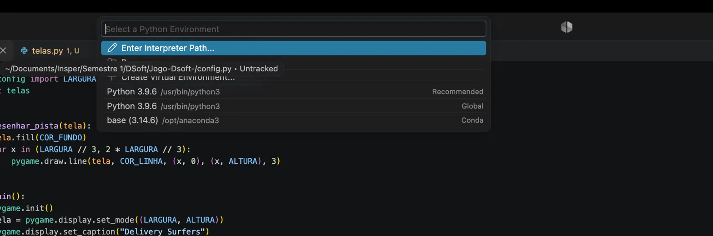
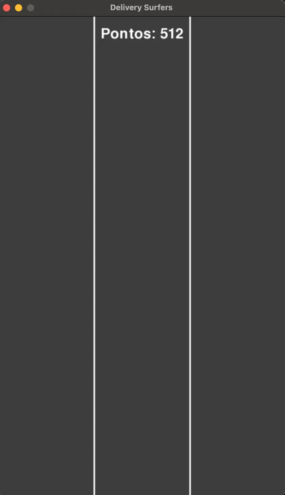
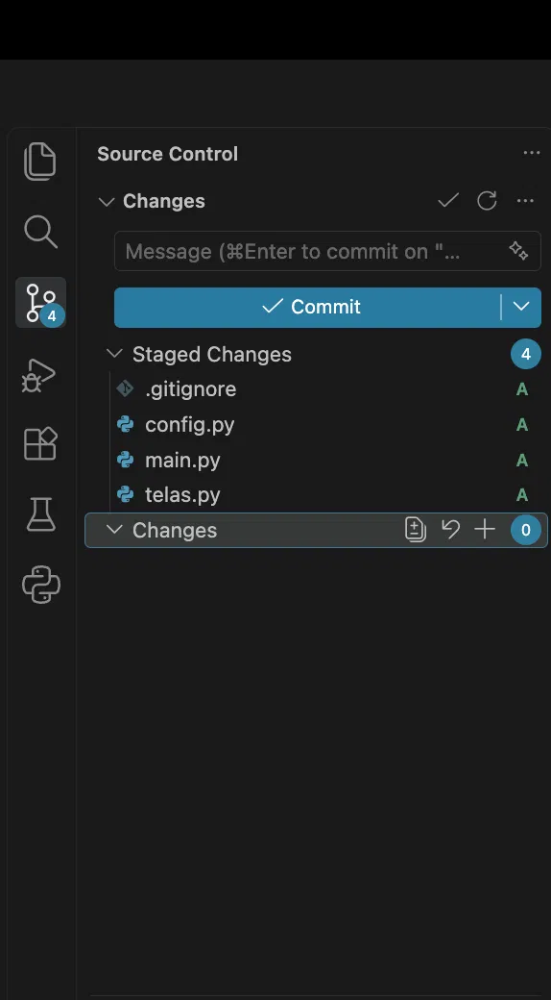
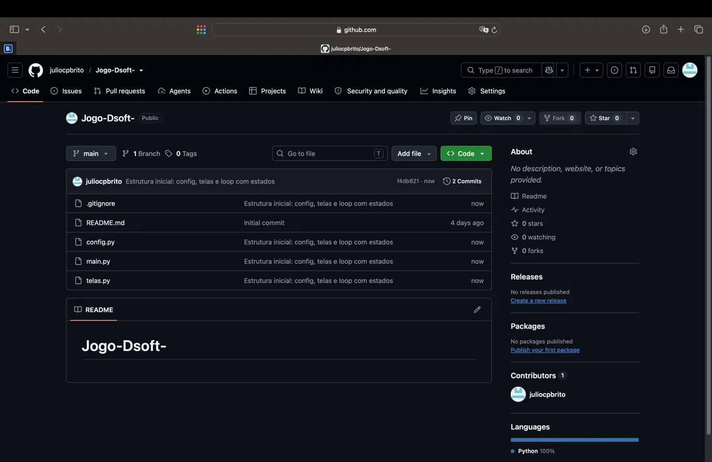
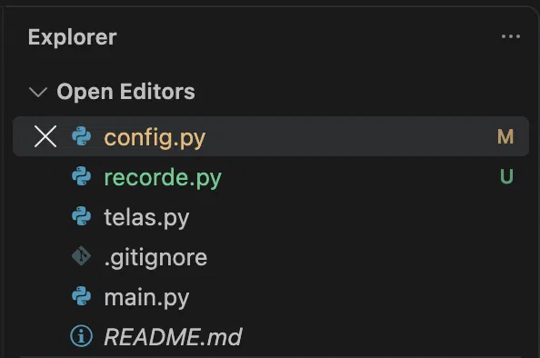
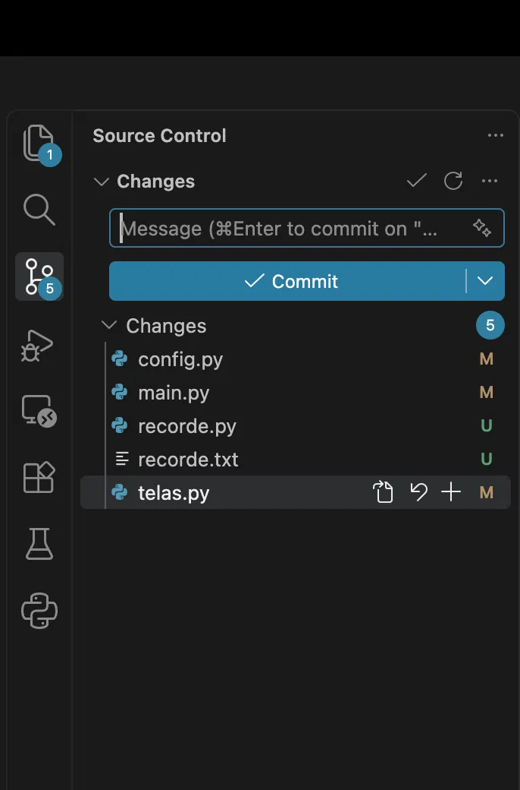
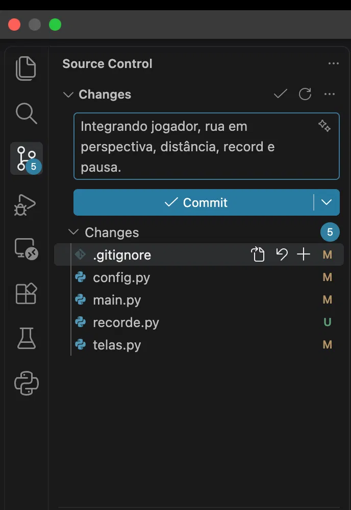
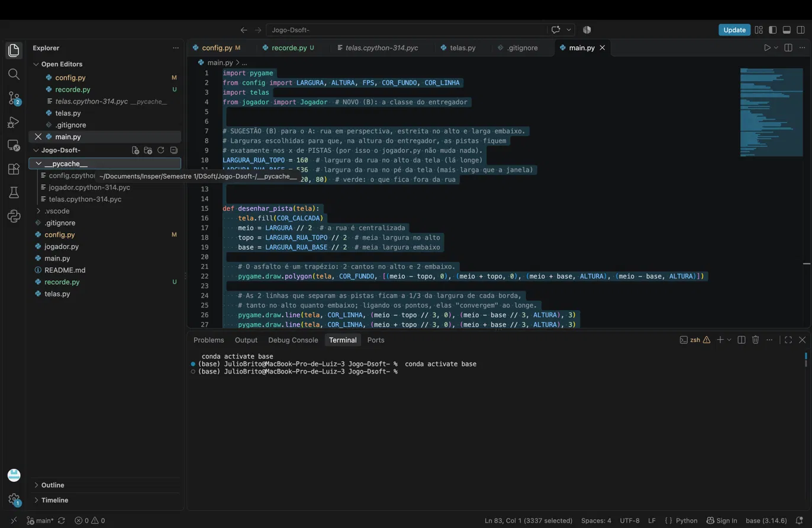
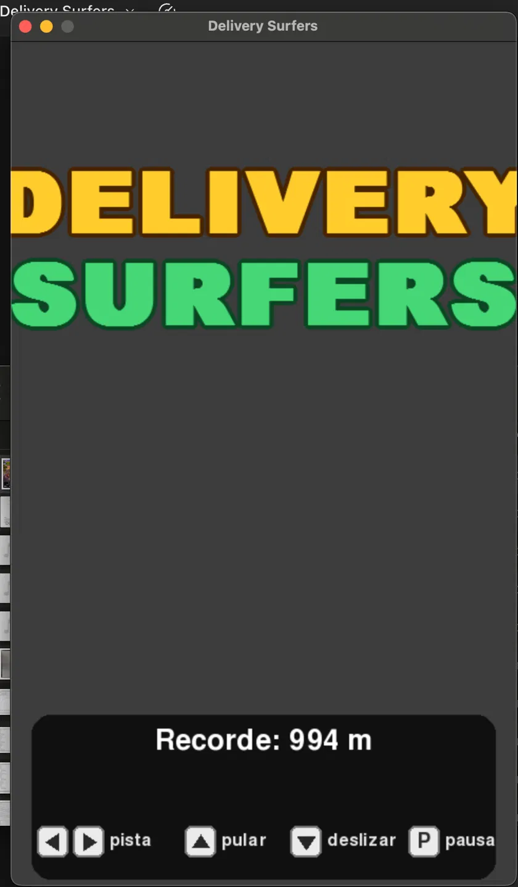
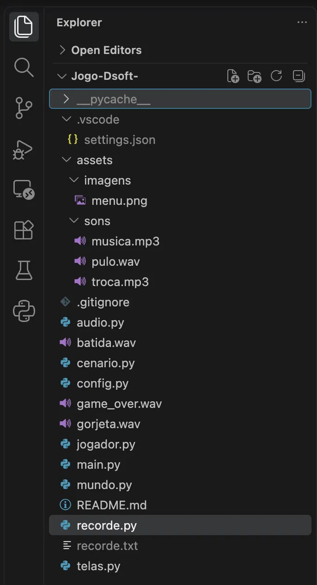

# Conversa do Julio com o Claude, parte 1 (15/11 a 19/11/2026)

Esta é a primeira parte da conversa do Julio Brito com o Claude (Anthropic) sobre o projeto Delivery Surfers. Ela cobre o início do projeto: a viabilidade da ideia, o conceito do jogo, a divisão de tarefas do grupo, o esqueleto do código, a estrutura inicial em vários arquivos e a configuração do repositório no GitHub.

**O que foi retirado:** os exercícios de Python da disciplina (PrairieLearn) que estavam no mesmo chat, porque não fazem parte do projeto. As imagens enviadas (capturas de tela) não aparecem neste texto.

A continuação (19/11 a 23/11) está em `julio-claude-2.md`.

---


### **Julio**

Meu projeto final é esse link: https://insper.github.io/DesignDeSoftware/projeto/ Estou em um grupo com mais duas pessoas, a nossa ideia, é fazer um jogo tipo o subway surfers, mas quem corre é tipo um entregador de ifood, seria delivery surfers, você acha que dá para fazer ?


### **Claude**

Dá, sim. O endless runner de 3 pistas é um dos jogos mais viáveis de fazer em PyGame, e o tema do entregador combina bem com o que a rubrica pede.

Por que é viável

A mecânica é simples: o jogador troca de pista (esquerda/direita), pula ou desliza, e obstáculos e moedas vêm na direção dele.
Não precisa de 3D. Dá para fazer em 2D visto de cima ou com um efeito simples de profundidade.
Cobre o que o enunciado pede: interação em tempo real, tela de início e de fim, pontuação, vida e som.

Ideias que reforçam o tema

Obstáculos: carros, buracos, cones, pedestres.
Moedas: gorjetas.
Vida: avaliação de estrelas, que cai a cada batida.
Power-ups: bike elétrica (turbo) e capacete (escudo).
Pontuação: entregas concluídas, com velocidade crescente.

Como chegar ao conceito A (50% da nota é jogabilidade)

Use classes (Jogador, Obstaculo, Moeda) e separe o código em arquivos.
Use pygame.sprite e grupos de sprites.
Tenha animação de sprites, vários sons e recorde salvo em arquivo. Isso também cumpre o requisito de usar algo não visto em aula.

Pontos que merecem atenção

Prazo curto. A entrega no GitHub é 23/11 às 12h, a mesma hora da Feira de Jogos (presença obrigatória). Faltam 8 dias, então monte primeiro uma versão mínima jogável e só depois acrescente os extras.
Proposta inicial. O prazo no Blackboard era 09/11. Se o grupo ainda não enviou, vale falar com o professor logo, já que o enunciado exige discutir o tema com ele.
Prova individual em 25/11. A nota do projeto é o menor valor entre o projeto e a prova, e cada um precisa entender todo o código. Dividam o trabalho, mas todo mundo deve ler o jogo inteiro.
Commits dos três. Se só um usuário fizer commits, isso vira conceito I ou D no trabalho em equipe.
Uso de IA. É permitido, mas precisa ser documentado no README e a interação anexada, e vocês precisam entender o que foi gerado.
Arte original. Não use logo do iFood nem assets ou personagens do Subway Surfers. Use sprites próprios ou de pacotes gratuitos, com crédito.
README e vídeo. O README precisa de título, nomes, instruções para rodar e um link para um vídeo curto do jogo.

Quer que eu monte a estrutura inicial do jogo (janela, 3 pistas e movimento do jogador) para vocês dividirem as tarefas a partir daí?

Sources: Projeto Final – Design de Software (Insper)


### **Julio**

Ok, onde nós fazemos o código ?


### **Claude**

No VS Code, no computador de vocês. Aqui no chat eu escrevo e corrijo o código, mas o PyGame abre uma janela e precisa rodar na máquina de vocês.

Configuração (uns 10 minutos)

Um de vocês cria o repositório no GitHub (ex.: delivery-surfers) e adiciona os outros dois como colaboradores. Se for privado, adicione também o professor, como o enunciado exige.
Os três clonam o repositório e abrem a pasta no VS Code:
git clone <link-do-repositorio>
Instalem o PyGame no terminal:
pip install pygame
Cada um trabalha numa branch ou em arquivos diferentes e faz commit com o próprio usuário. Isso garante os commits dos três (conceito de trabalho em equipe) e evita conflito, porque duas pessoas editando o mesmo arquivo dão trabalho.

Esqueleto inicial

Salvem como main.py na pasta do repositório. Ele abre a janela com 3 pistas e um quadrado vermelho (o entregador) que troca de pista com as setas ← →. Testei aqui sem janela e roda sem erro.

python
```python
import pygame

LARGURA, ALTURA = 480, 800
PISTAS = [LARGURA // 6, LARGURA // 2, 5 * LARGURA // 6]  # centro de cada pista


def main():
    pygame.init()
    tela = pygame.display.set_mode((LARGURA, ALTURA))
    pygame.display.set_caption("Delivery Surfers")
    relogio = pygame.time.Clock()

    pista = 1  # 0 = esquerda, 1 = meio, 2 = direita
    jogador = pygame.Rect(0, 0, 50, 80)
    jogador.midbottom = (PISTAS[pista], ALTURA - 40)

    rodando = True
    while rodando:
        for evento in pygame.event.get():
            if evento.type == pygame.QUIT:
                rodando = False
            elif evento.type == pygame.KEYDOWN:
                if evento.key == pygame.K_LEFT and pista > 0:
                    pista -= 1
                elif evento.key == pygame.K_RIGHT and pista < 2:
                    pista += 1
                jogador.centerx = PISTAS[pista]

        tela.fill((60, 60, 60))
        for x in (LARGURA // 3, 2 * LARGURA // 3):
            pygame.draw.line(tela, (230, 230, 230), (x, 0), (x, ALTURA), 3)
        pygame.draw.rect(tela, (234, 29, 44), jogador)

        pygame.display.flip()
        relogio.tick(60)

    pygame.quit()


if __name__ == "__main__":
    main()
```

Rodem com python main.py. Se a janela abrir e o quadrado trocar de pista, o ambiente de todo mundo está pronto.

Próximo passo: com isso funcionando, o passo seguinte é fazer obstáculos descerem pela tela, com colisão e vida. Me avisa quando rodar, ou me manda o erro se algo falhar, que eu continuo daí.


### **Julio**

Ok, o jogo utiliza coisas que eu aprendi, precisa entender isso, já que vou fazer uma prova sobre isso


### **Claude**

Boa ideia, é exatamente o que a prova cobra. Vou escrever o código no nível do que você já domina (funções, listas, dicionários, for, while, if) e explicar cada parte antes de avançarmos. Quando o jogo precisar de algo novo, como classes ou sprites, eu aviso e explico o porquê.

Para começar, esta é a lógica do esqueleto que mandei:

Constantes no topo (LARGURA, ALTURA, PISTAS): PISTAS é uma lista com a posição x do centro de cada pista. A pista 0, 1 ou 2 vira um índice dessa lista, então PISTAS[pista] dá o x onde o jogador deve ficar.
pygame.init() e set_mode: abrem a janela e criam a tela, onde tudo é desenhado.
O loop principal (while rodando): é o coração de todo jogo. A cada volta ele faz as mesmas 3 coisas:
Eventos: lê o que o jogador fez (fechar a janela, apertar seta).
Atualização: muda o estado do jogo (aqui, a variável pista e a posição do jogador).
Desenho: pinta o fundo, as linhas das pistas e o jogador, e o display.flip() mostra o quadro pronto.
relogio.tick(60): limita o jogo a 60 voltas por segundo, para ele rodar no mesmo ritmo em qualquer computador.
Troca de pista: pista é um número de 0 a 2. A seta esquerda faz pista -= 1 (só se pista > 0) e a direita faz pista += 1 (só se pista < 2). Os if evitam sair da estrada.

Para eu acertar o nível, me diga o que vocês já viram de PyGame em aula, por exemplo: loop principal e eventos, Rect e colisão, imagens (blit), pygame.sprite e classes, som. Assim eu uso o que já foi ensinado e destaco só o que for novo.


### **Julio**

Não vimos isso. Você pode usar mas tem que detalhar oque é cada coisa.


### **Claude**

Combinado. Estas são as coisas do PyGame que aparecem no esqueleto, explicadas uma a uma.

Ideia geral: o PyGame é uma biblioteca de funções e objetos para criar jogos. Em import pygame, tudo o que começa com pygame. vem dela.

Coordenadas: na tela, o ponto (0, 0) fica no canto superior esquerdo. O x cresce para a direita e o y cresce para baixo. Isso é o contrário do plano cartesiano da matemática, e vai importar quando os obstáculos descerem.

Código	O que é
pygame.init()	Liga os módulos do PyGame (vídeo, som, teclado). Vem antes de tudo.
pygame.display.set_mode((480, 800))	Cria a janela com 480 de largura e 800 de altura. Os dois valores vão entre parênteses duplos porque são uma tupla (um par). Devolve a tela, que é uma Surface, uma "folha em branco" onde desenhamos tudo.
pygame.display.set_caption(...)	Muda o título da janela.
pygame.time.Clock()	Cria um relógio para controlar o tempo do jogo.
relogio.tick(60)	Faz o jogo esperar o suficiente para rodar no máximo 60 quadros por segundo (FPS). Sem isso, cada computador rodaria numa velocidade diferente.
pygame.Rect(x, y, largura, altura)	Um retângulo, que guarda posição e tamanho. Usamos um para o jogador. Ele tem atributos que podem ser lidos e alterados, como centerx (x do centro) e midbottom (ponto do meio da base). Mais tarde vamos usar o Rect para detectar colisões.
pygame.event.get()	Devolve uma lista de eventos (coisas que o jogador fez desde o último quadro). Por isso o for evento in ....
evento.type == pygame.QUIT	Evento de clicar no X da janela. Aqui fazemos rodando = False para sair do while.
evento.type == pygame.KEYDOWN	Evento de uma tecla que acabou de ser apertada (acontece uma vez por aperto, não repete segurando).
evento.key == pygame.K_LEFT	Descobre qual tecla foi (seta esquerda). Também existem K_RIGHT, K_UP, K_SPACE etc.
tela.fill((60, 60, 60))	Pinta a tela inteira de uma cor. A cor é uma tupla RGB (vermelho, verde, azul), cada valor de 0 a 255. (60, 60, 60) é cinza-escuro.
pygame.draw.line(tela, cor, início, fim, espessura)	Desenha uma linha. Usamos para as divisórias das pistas.
pygame.draw.rect(tela, cor, jogador)	Desenha um retângulo pintado na posição do Rect.
pygame.display.flip()	O jogo desenha tudo numa tela escondida e o flip() mostra o quadro pronto. Sem ele, a janela não atualiza.
pygame.quit()	Desliga o PyGame ao terminar.
if __name__ == "__main__":	Chama main() só quando você roda o arquivo direto, e não quando ele é importado por outro arquivo. Vai ser útil quando separarmos o código em vários arquivos.

Para a prova: o que mais cai em jogos assim é o loop principal (eventos, atualiza, desenha, repete) e como o estado do jogo é guardado em variáveis, como pista e jogador. Se você explicar esses dois pontos com suas palavras, já está bem encaminhado.

Rode o main.py e me confirme se a janela abriu e o quadrado troca de pista. Aí o próximo passo é fazer obstáculos descerem e detectar a batida, explicando cada pedaço novo do mesmo jeito.


### **Julio**

Ok, precisamos entender oque é tudo do jogo, e oque cada integrante da equipe vai fazer.


### **Claude**

O que é o jogo (peças)
Peça	O que faz
Telas (estados)	Menu inicial, jogando, game over. Uma variável estado diz qual tela está ativa.
Jogador	O entregador. Troca de pista, tem vidas e pode ficar invencível por alguns segundos depois de bater.
Obstáculos	Carros, cones e buracos nascem no topo, em uma pista sorteada, e descem. Se o jogador encosta, perde uma vida.
Itens	Gorjetas (moedas) dão pontos. Power-ups, como o escudo, dão vantagens por um tempo.
Dificuldade	A velocidade aumenta com o tempo.
Placar e vidas	Entregas ou pontos e vidas (estrelas) na tela, com recorde salvo em arquivo.
Arte e som	Sprites (imagens), música de fundo e efeitos (batida, moeda).
Entrega	README, vídeo e GitHub.
Arquivos (um dono por arquivo evita conflito no Git)
main.py        -> loop e troca de telas
config.py      -> constantes (tamanho da tela, cores, velocidades)
jogador.py     -> o entregador
mundo.py       -> obstáculos, moedas, power-ups, spawn
telas.py       -> menu, game over, placar
assets/        -> imagens e sons
README.md
Divisão entre os 3
Pessoa	Responsabilidade
A: Núcleo	main.py, config.py e telas.py: loop, menu, game over, placar, recorde, pause. Sons de fundo e menu. Faz a integração das partes.
B: Jogador	jogador.py: movimento, vidas, invencibilidade, pulo ou deslize, power-ups no jogador. Sprite e animação do entregador.
C: Mundo	mundo.py: obstáculos, moedas, sorteio de pista, velocidade crescente, colisão com o jogador. Sprites dos obstáculos e efeitos sonoros.

Todos fazem commits, e o README e o vídeo ficam com quem tiver mais tempo no fim.

Cronograma (8 dias)
Hoje a ter 17/11: versão mínima jogável. Pistas, jogador, obstáculos descendo, colisão, vidas e game over.
Qua 18 a sex 20: menu, placar, moedas e power-ups, sprites e sons.
Sáb 21 e dom 22: corrigir bugs, README, vídeo e congelar o código no domingo à noite.
Seg 23: só conferir que o GitHub está atualizado antes das 12h.
Regras para dar certo
Combinem os "contratos" antes de codar. Por exemplo: todo obstáculo tem um rect e um método para descer, e o jogador tem rect e vidas. Assim cada um trabalha sem depender do código dos outros.
Uma branch por pessoa e git pull antes de cada git push. Commits pequenos e frequentes.
Para a prova, todos precisam entender tudo. Depois de cada parte pronta, o dono explica o código para os outros dois, em 10 minutos.
Usos de IA vão para o README, como o enunciado exige.

Quando o jogo precisar de classes (o Jogador e o Obstaculo vão virar classes), eu explico do zero antes, já que são novidade.

Quem fica com cada papel? Com isso definido, eu preparo o esqueleto de cada arquivo já com a divisão, para cada um começar pelo seu.


### **Julio**

Ok, vamos imaginar o jogo primeiro, o corredor vai ser um entregador, os obstaculos precisam ter a ver com o contexto e quem vai correr atrás do entregador


### **Claude**

Vou propor opções para vocês escolherem. Sempre que possível, uso coisas que já existem no dia a dia de um entregador.

Quem corre atrás do entregador
Perseguidor	Por quê funciona
Cliente com fome e atrasado	É o mais ligado ao tema. Ele corre atrás reclamando do atraso e, se alcança, a avaliação vai para 1 estrela.
Cachorro bravo	Clássico de rua e fácil de desenhar e animar.
Dono do restaurante	Ele quer o pedido de volta porque o entregador "sumiu" com a comida.
Fiscal de trânsito	Persegue quem corre demais ou desrespeita a lei.

Minha sugestão é o cliente com fome, porque conta uma história sem precisar de explicação (o jogador entende a ideia só de ver).

Uma mecânica que simplifica o jogo: em vez de um contador de vidas, o perseguidor fica na tela, atrás do jogador. Cada batida num obstáculo deixa ele mais perto. Se ele alcança, é game over. Se o jogador pega moedas ou fica um tempo sem bater, ele se afasta de novo. Isso é mais divertido, dá tensão visual e usa só uma variável (a distância dele).

Obstáculos (pelo contexto da rua)
Trânsito: carros, ônibus, caminhão de lixo.
Rua: buracos, bueiro aberto, poça d'água, lombada, cones de obra.
Pessoas: pedestre distraído com o celular, vendedor ambulante com carrinho.
Outros: moto parada, caçamba de entulho, semáforo com carros cruzando.

Dá para variar o tipo de desvio: uns exigem trocar de pista, outros dá para pular (buraco, lombada) e alguns dá para passar por baixo (placa, galho).

Itens
Gorjeta: moeda que dá pontos.
Pedido extra: bônus maior, como uma sacola de comida.
Capacete: escudo que aguenta uma batida.
Café ou energético: turbo por alguns segundos.
GPS: mostra o próximo obstáculo ou afasta o perseguidor.
Objetivo e placar

O placar pode ser entregas concluídas (conta distância e pedidos coletados). O recorde fica salvo em arquivo, e a dificuldade sobe a cada X metros.

Cenário (para o conceito A)

Rua da cidade com prédios ao fundo, mudança de cenário por fase (dia, noite, chuva) e música de trânsito. Para o escopo de 8 dias, o essencial é 1 cenário, 4 a 5 tipos de obstáculo, gorjetas e o perseguidor. O resto entra se sobrar tempo.

Um alerta de segurança jurídica: deixem o nome e o visual do entregador genéricos (sem logo ou cor oficial de aplicativo de entrega real).

Qual perseguidor vocês preferem? Com isso fechado, definimos o resto do conceito e eu monto a divisão de tarefas.


### **Julio**

O perseguidor vai ser o cliente com fome mesmo. Vamos tentar deixar o jogo sem muitos itens, tipo o subway surfers mesmo.


### **Claude**

Fechado. Fica um jogo enxuto, no estilo do Subway Surfers, que cabe em 8 dias.

Delivery Surfers: o conceito

História: o cliente está faminto e o pedido atrasou. O entregador corre pela rua com a comida e o cliente vem atrás.

Controles:

← → trocam de pista (3 pistas)
↑ pula
↓ desliza (se der tempo)

Obstáculos (só 4 tipos):

Obstáculo	Como desviar
Carro ou ônibus	Trocar de pista
Cone ou lombada	Pular
Buraco	Pular ou trocar de pista
Placa ou barreira baixa	Deslizar (se der tempo)

Itens: só a gorjeta (moeda), em fileiras, que dá pontos. Se sobrar tempo, entra um único power-up, o capacete (escudo).

Perseguidor (o cliente com fome):

Aparece atrás do jogador, no pé da tela.
A 1ª batida deixa ele colado no entregador.
A 2ª batida seguida, ele alcança e dá game over.
Passando um tempo sem bater, ele se afasta de novo.

Ritmo: a velocidade aumenta aos poucos, e o placar conta a distância percorrida mais as gorjetas.

Telas: menu inicial, jogo e game over (com pontuação e recorde).

Ordem de construção
Pistas e jogador trocando de pista (já temos).
Obstáculos descendo e colisão.
O perseguidor e a regra das 2 batidas.
Pulo.
Gorjetas e placar.
Menu e game over.
Sprites e sons.
Deslizar e o capacete, só se sobrar tempo.

Se os passos 1 a 6 estiverem prontos até quarta, já é um jogo completo no nível B. O resto é polimento para o A.

Esse conceito também serve como "rascunho de design" no README, que a rubrica valoriza no trabalho em equipe.

Falta definir quem faz o quê entre vocês três. Se me disser como vocês preferem dividir, ou me deixar sugerir pelas peças acima (jogador, mundo, telas), eu monto a lista de tarefas de cada um já com os arquivos.


### **Julio**

Ok, então vamos fazer o passo a passo do que deve ser feito, dividindo as funções de cada um


### **Claude**

Delivery Surfers: Plano e Divisão de Tarefas
Claude Docs
·Only you

Montando o documento com o plano e a divisão de tarefas. A tabela de papéis já está pronta, agora preencho o passo a passo por dia, as regras do grupo e o checklist de entrega.

Montei o plano completo do Delivery Surfers em um documento: papéis de A, B e C com os arquivos de cada um, o cronograma dia a dia até a prova de 25/11, as regras de Git e de estudo, e o checklist da entrega de 23/11. Quando acharem que algo deve mudar, é só editar direto ou comentar nele que eu ajusto.

O documento é privado até você compartilhar pelo menu Share. Os outros dois só conseguem abrir o link depois disso.

Combinem entre vocês quem é A, B e C. Quando decidirem, eu preparo o esqueleto do arquivo de cada um (jogador.py, mundo.py e telas.py) para cada pessoa começar pelo seu.


### **Julio**

onde eu deveria ter mandado a proposta ?


### **Claude**

Verificando o prazo e o envio no Blackboard.

No Blackboard. A página do projeto diz que a proposta inicial é enviada por um formulário no Blackboard, com prazo em 09/11/2026. O endereço do repositório do GitHub também deve ser enviado lá, de preferência no começo do projeto.

A página também pede que o tema seja discutido com o professor antes. Ela não diz em que parte da disciplina fica o formulário, então procurem na área do curso de Design de Software no Blackboard.

Como o prazo já passou, o caminho mais seguro é avisar o professor hoje, por e-mail ou pessoalmente. Digam que o grupo definiu o jogo (Delivery Surfers, um endless runner de 3 pistas) e peçam para enviar a proposta e o link do repositório agora. Se o grupo já tinha enviado a proposta, ignorem isso.

Se quiserem, eu escrevo o e-mail para o professor.


### **Julio**

ok, sou o A, então ja vamos começar a fazer os códigos


### **Claude**

Os três arquivos do Núcleo estão prontos. Testei o loop completo sem abrir janela (menu, jogo, game over e reinício) e a tela de game over renderizou certo, com o "Ç" de ESPAÇO.

Crie os três na pasta do repositório. O main.py substitui o esqueleto que eu mandei antes.

config.py

python
```python
# Constantes do jogo. Se quiser mudar um valor, mude aqui e vale para todos os arquivos.

LARGURA = 480
ALTURA = 800
FPS = 60

# x do centro de cada pista (0 = esquerda, 1 = meio, 2 = direita)
PISTAS = [LARGURA // 6, LARGURA // 2, 5 * LARGURA // 6]

COR_FUNDO = (60, 60, 60)
COR_LINHA = (230, 230, 230)
COR_TEXTO = (255, 255, 255)
```

telas.py

python
```python
import pygame
from config import LARGURA, ALTURA, COR_FUNDO, COR_TEXTO


def escrever(tela, texto, tamanho, y):
    """Escreve um texto centralizado na horizontal, na altura y."""
    fonte = pygame.font.Font(None, tamanho)
    imagem = fonte.render(texto, True, COR_TEXTO)
    retangulo = imagem.get_rect(center=(LARGURA // 2, y))
    tela.blit(imagem, retangulo)


def desenhar_menu(tela):
    tela.fill(COR_FUNDO)
    escrever(tela, "DELIVERY SURFERS", 56, ALTURA // 3)
    escrever(tela, "Aperte ESPAÇO para jogar", 32, ALTURA // 2)


def desenhar_placar(tela, pontos):
    escrever(tela, "Pontos: " + str(pontos), 36, 30)


def desenhar_game_over(tela, pontos):
    tela.fill(COR_FUNDO)
    escrever(tela, "GAME OVER", 64, ALTURA // 3)
    escrever(tela, "Pontos: " + str(pontos), 40, ALTURA // 2)
    escrever(tela, "Aperte ESPAÇO para jogar de novo", 28, ALTURA // 2 + 60)
```

main.py

python
```python
import pygame
from config import LARGURA, ALTURA, FPS, COR_FUNDO, COR_LINHA
import telas


def desenhar_pista(tela):
    tela.fill(COR_FUNDO)
    for x in (LARGURA // 3, 2 * LARGURA // 3):
        pygame.draw.line(tela, COR_LINHA, (x, 0), (x, ALTURA), 3)


def main():
    pygame.init()
    tela = pygame.display.set_mode((LARGURA, ALTURA))
    pygame.display.set_caption("Delivery Surfers")
    relogio = pygame.time.Clock()

    estado = "menu"  # "menu", "jogando" ou "game_over"
    pontos = 0

    rodando = True
    while rodando:
        # 1) Eventos
        for evento in pygame.event.get():
            if evento.type == pygame.QUIT:
                rodando = False
            elif evento.type == pygame.KEYDOWN:
                if evento.key == pygame.K_SPACE:
                    if estado == "menu" or estado == "game_over":
                        estado = "jogando"
                        pontos = 0
                elif evento.key == pygame.K_ESCAPE and estado == "jogando":
                    estado = "game_over"  # TEMPORÁRIO: simula perder o jogo

        # 2) Atualização e 3) Desenho, de acordo com o estado
        if estado == "menu":
            telas.desenhar_menu(tela)
        elif estado == "jogando":
            pontos += 1  # TEMPORÁRIO: depois vira distância percorrida
            desenhar_pista(tela)
            telas.desenhar_placar(tela, pontos)
        else:
            telas.desenhar_game_over(tela, pontos)

        pygame.display.flip()
        relogio.tick(FPS)

    pygame.quit()


if __name__ == "__main__":
    main()
```

Para testar: rode python main.py. O menu aparece, ESPAÇO começa o jogo (os pontos sobem), ESC simula perder (é temporário, até B e C terminarem) e ESPAÇO joga de novo.

O que é novo aqui
Importar seus próprios arquivos. Cada .py é um módulo. from config import LARGURA, ALTURA traz essas constantes, e import telas permite chamar telas.desenhar_menu(tela). Assim as constantes ficam num lugar só.
Estado do jogo. estado é uma variável de texto que diz em qual tela estamos. O if / elif / else desenha a tela certa, e as trocas acontecem nos eventos (ESPAÇO muda para "jogando").
Escrever texto na tela:
pygame.font.Font(None, 56) cria uma fonte padrão de tamanho 56.
fonte.render(texto, True, cor) transforma o texto numa imagem (o True deixa as bordas suaves).
imagem.get_rect(center=(x, y)) devolve um Rect com o centro no ponto pedido, que é o que centraliza o texto.
tela.blit(imagem, retangulo) cola a imagem na tela.
"""...""" logo abaixo do def é a docstring, que explica o que a função faz. A rubrica valoriza isso para o conceito A.
Próximos passos
Subam o código para o GitHub, para B e C puxarem:
git add config.py telas.py main.py
git commit -m "Estrutura inicial: config, telas e loop com estados"
git push
Mandem o contrato abaixo para B e C. Ele diz quais nomes o main.py vai chamar quando eu integrar o código deles:
jogador.py (B):
  class Jogador: .rect | trocar_pista(direcao: -1 ou +1) | atualizar() | desenhar(tela)
  class Perseguidor: levar_batida() | alcancou() -> True/False | atualizar() | desenhar(tela)

mundo.py (C):
  class Mundo: atualizar() | desenhar(tela)
           bateu(rect) -> True/False | pegou_gorjetas(rect) -> quantidade

Constantes (tamanho da tela, pistas, cores): importar de config.py
Quando B e C entregarem, eu mostro como chamar essas classes dentro do estado "jogando" e como ligar a batida ao perseguidor.

O ponto 2 é uma proposta, e B e C podem pedir ajustes. O importante é combinar os nomes antes de cada um codar.


### **Julio**

Como eu conecto o repositório ao VS Code


### **Claude**

Faça pelo VS Code, em 3 etapas. Os passos abaixo são para Mac.

1. Criar o repositório no GitHub (só uma pessoa)
Entre em github.com/new, dê o nome (ex.: delivery-surfers) e marque Add a README file. Isso já cria o repositório com um commit inicial.
Em Settings → Collaborators → Add people, adicione B e C. Se o repositório for privado, adicione também o professor.
Copie o link do repositório (botão verde Code, endereço que termina em .git).
2. Clonar no VS Code
Abra o VS Code e aperte Cmd + Shift + P (Command Palette).
Digite Git: Clone e escolha essa opção.
Cole o link do repositório e aperte Enter.
Escolha a pasta do computador onde ele será salvo e clique em Select as Repository Destination.
Quando o VS Code perguntar, clique em Open.
Se pedir login, autorize pelo navegador na conta do GitHub.

Se o VS Code disser que o Git não está instalado, instale pelo terminal com xcode-select --install ou pelo site git-scm.com, e feche e abra o VS Code de novo.

3. Configurar seu nome nos commits

No terminal do VS Code (menu Terminal → New Terminal), rode com seus dados reais, igual no GitHub:

git config --global user.name "Seu Nome"
git config --global user.email "seu-email-do-github@exemplo.com"

Isso é importante porque a rubrica avalia se os commits vêm dos três integrantes. Sem essa configuração, o commit pode sair com o nome errado.

Como enviar o código depois

Mova os arquivos (main.py, config.py, telas.py) para dentro da pasta clonada. Depois, no VS Code:

Abra o painel Source Control (ícone de ramificação na barra lateral esquerda).
Clique no + ao lado de cada arquivo (isso é o git add).
Escreva uma mensagem no campo de cima, por exemplo "Estrutura inicial: config, telas e loop com estados".
Clique em Commit e depois em Sync Changes (ou Publish/Push).

B e C vão usar os mesmos passos, só que começando pelo item 2, com o link que você mandar.

Se você já criou o repositório e ainda não clonou, me diga o que apareceu na tela e eu ajudo a seguir.


### **Julio**

Ok, repositório foi colocado no VS Code


### **Claude**

Boa. Agora é colocar o código lá e avisar os outros dois.

Copie main.py, config.py e telas.py para dentro da pasta do repositório que o VS Code abriu. Se os arquivos já estão nela, pule este passo.
Crie um arquivo .gitignore na mesma pasta, com esta linha dentro:
__pycache__/

Assim o Git ignora a pasta de arquivos temporários que o Python gera, e ela não polui os commits dos três.
3. Rode python main.py pelo terminal do VS Code e confirme que o menu abre.
4. Faça o commit e o push pelo painel Source Control, como no passo a passo que mandei. Pode usar a mensagem "Estrutura inicial: config, telas e loop com estados".
5. Mande para B e C o link do repositório e o contrato que passei antes (os nomes das classes e métodos). Peçam que cada um comece com git pull, crie a própria branch e trabalhe só no seu arquivo (jogador.py e mundo.py).

Depois do push, confira no GitHub (pelo navegador) se os arquivos apareceram. Se aparecerem, está tudo certo.

Enquanto B e C trabalham, a gente avança no que é seu: trocar os pontos "por quadro" por distância percorrida e salvar o recorde em arquivo. Me avisa quando o push estiver feito que eu começo por aí.


### **Julio**

Como assim copie o main.py, config.py, Não entendi


### **Claude**

Desculpe, expliquei de forma confusa. Os códigos que mandei estão só aqui na conversa. Você precisa criar os arquivos no VS Code e colar o código dentro de cada um.

Faça assim, com o repositório aberto no VS Code:

Clique no ícone de Explorer (os dois papeizinhos, no topo da barra lateral esquerda). Aparece o nome da pasta do repositório.
Passe o mouse sobre o nome da pasta e clique no ícone de New File (uma folha com um "+"). Ou clique com o botão direito na pasta e escolha New File.
Digite o nome config.py e aperte Enter.
O arquivo abre vazio. Cole o código do config.py que está na minha mensagem anterior e aperte Cmd + S para salvar.
Repita para o telas.py e para o main.py, cada um com o seu código.
Crie também um arquivo chamado .gitignore (com o ponto na frente) e escreva dentro dele só __pycache__/.

No fim, o Explorer deve mostrar: README.md, config.py, telas.py, main.py e .gitignore.

Se você já tinha um main.py com o esqueleto antigo, não crie outro. Abra esse e troque todo o conteúdo pelo código novo.

Quando os arquivos estiverem criados, rode no terminal do VS Code:

python main.py

Me diga se a janela do jogo abriu com o menu.


### **Julio**

Ok, mas eu preciso dar commits não ?


### **Claude**

Sim, depois de criar os arquivos e testar que o jogo abre, é preciso fazer o commit e o push. O commit salva a versão no seu computador e o push envia para o GitHub, que é onde B e C (e o professor) vão ver o código. Sem o push, os outros dois não recebem nada.

Faça pelo VS Code:

Abra o painel Source Control, o ícone de ramificação na barra lateral esquerda. Ele deve mostrar um número, que é a quantidade de arquivos novos.
Clique no + ao lado de cada arquivo (main.py, config.py, telas.py e .gitignore), ou no + ao lado de "Changes" para adicionar todos de uma vez.
No campo de texto em cima, escreva a mensagem do commit:
Estrutura inicial: config, telas e loop com estados
Clique em Commit.
Clique em Sync Changes (ou Push, se aparecer esse nome). É esse botão que envia para o GitHub.

Se o VS Code perguntar se você quer fazer commit dos arquivos direto, pode aceitar. Se pedir login do GitHub, autorize pelo navegador.

Para conferir, abra a página do repositório no GitHub no navegador e veja se os arquivos aparecem. Se aparecerem, o push funcionou e você já pode mandar o link para B e C.

Esse processo (criar ou editar, commit, push) vale para todo código novo que vocês fizerem, e é isso que mostra para a rubrica que os três contribuíram.


---

## Capturas de tela enviadas ao Claude

Capturas que o Julio enviou durante esta parte da conversa, mostradas em ordem aproximada. Elas aparecem aqui em conjunto porque a cópia do texto da conversa não leva as imagens.

**Criação do `config.py` no VS Code (15/11).**


**Código do `telas.py` colado no VS Code.**


**Escolha do ambiente Python no VS Code.**



**Criação do `.gitignore` com `__pycache__/`.**


**Primeira tela de jogo: pista com 3 faixas e placar de pontos.**



**Arquivos preparados (staged) para o primeiro commit.**



**Repositório no GitHub após o primeiro push ("Estrutura inicial: config, telas e loop com estados").**



**`main.py` com a rua em perspectiva e a classe do jogador integrada.**


**Arquivos abertos no VS Code durante a integração.**



**Painel Source Control antes de escrever a mensagem do commit.**



**Source Control com `recorde.py` e `recorde.txt` novos.**


**Mensagem do commit "Integrando jogador, rua em perspectiva, distância, record e pausa".**



**Aviso do VS Code perguntando se faz o commit direto, com um erro de `recorde.carregar` no terminal.**


**Primeira tela de game over, com distância e recorde.**



**Música de fundo (`musica.mp3`) adicionada em `assets/sons`.**


**Arte do menu (`menu.png`) adicionada em `assets`.**


**Menu rodando no jogo, com recorde e teclas de controle.**



**Organização das pastas de sons e imagens do projeto.**



